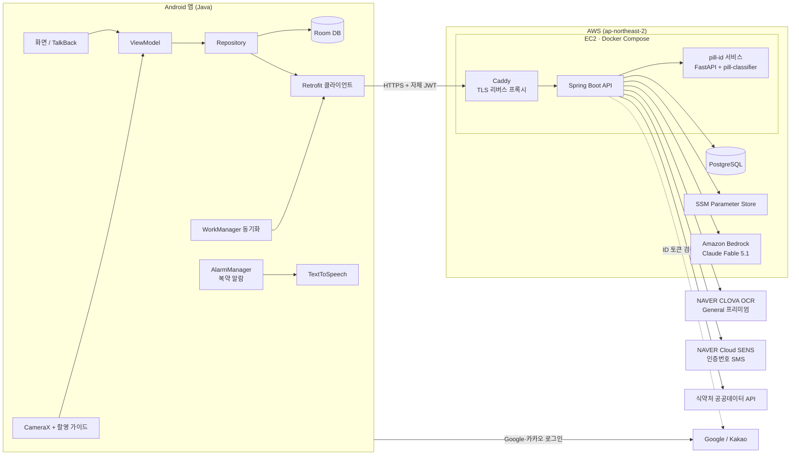
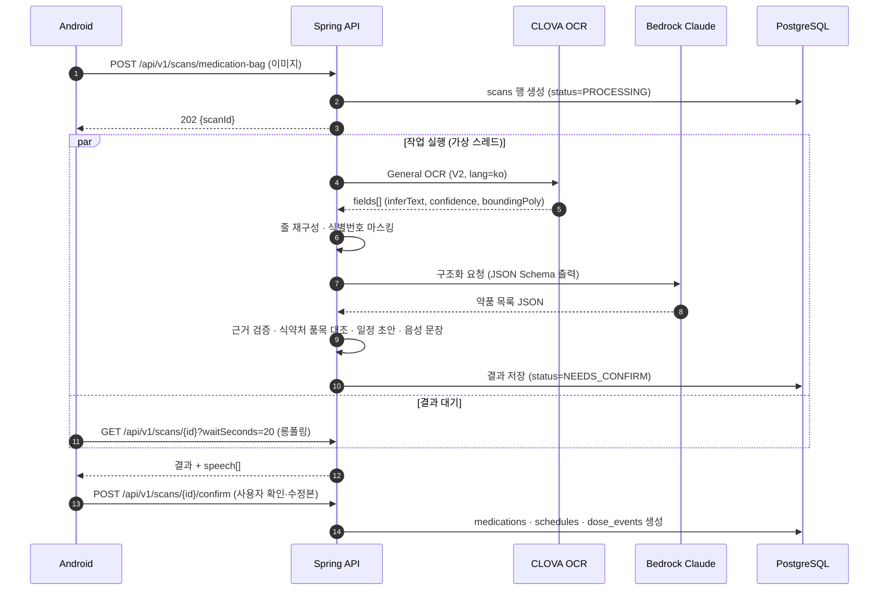
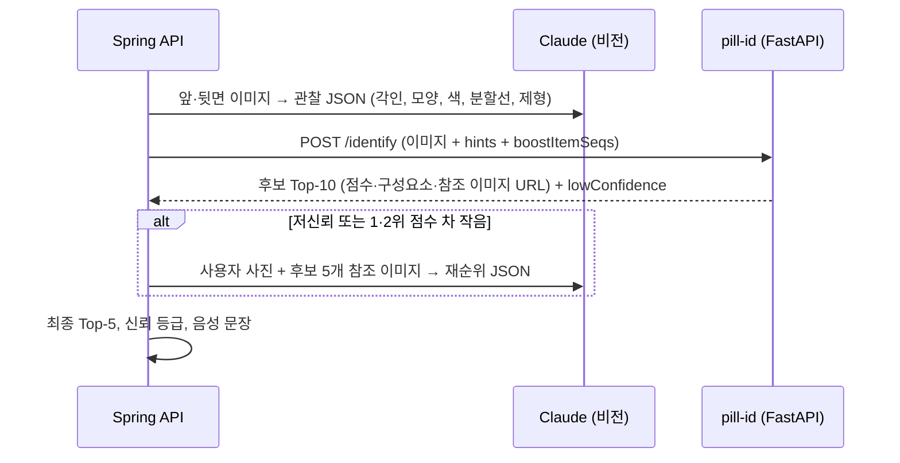
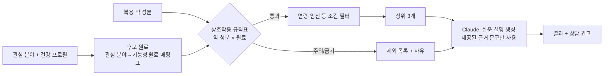
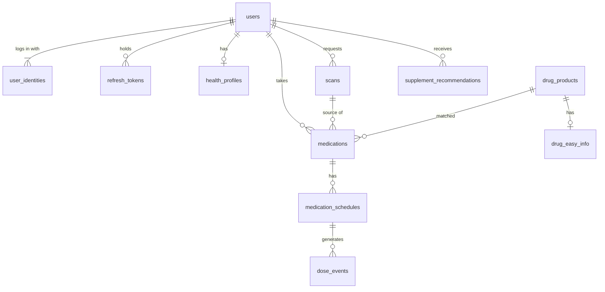
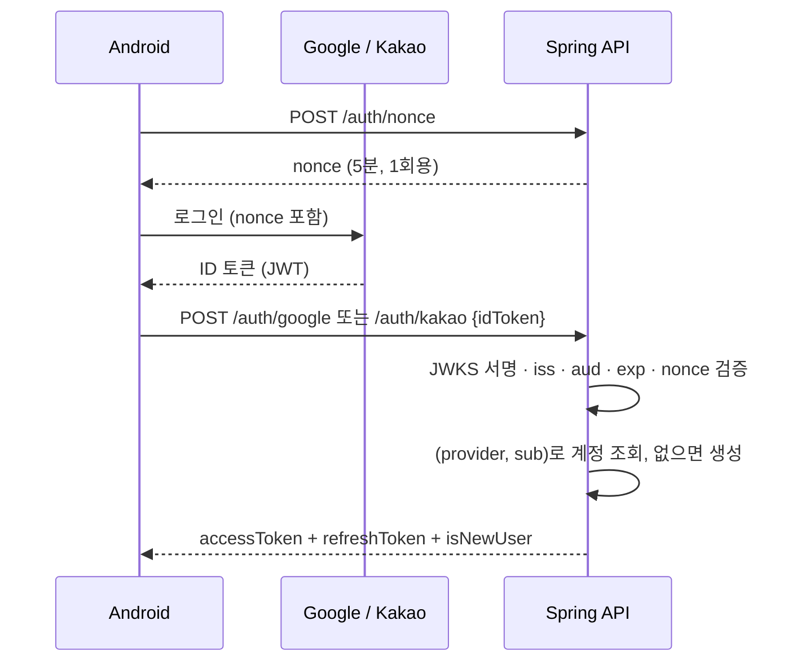
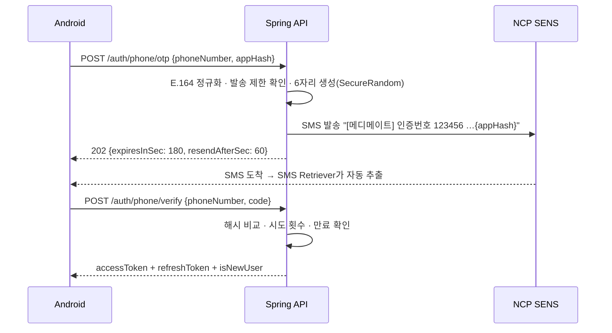
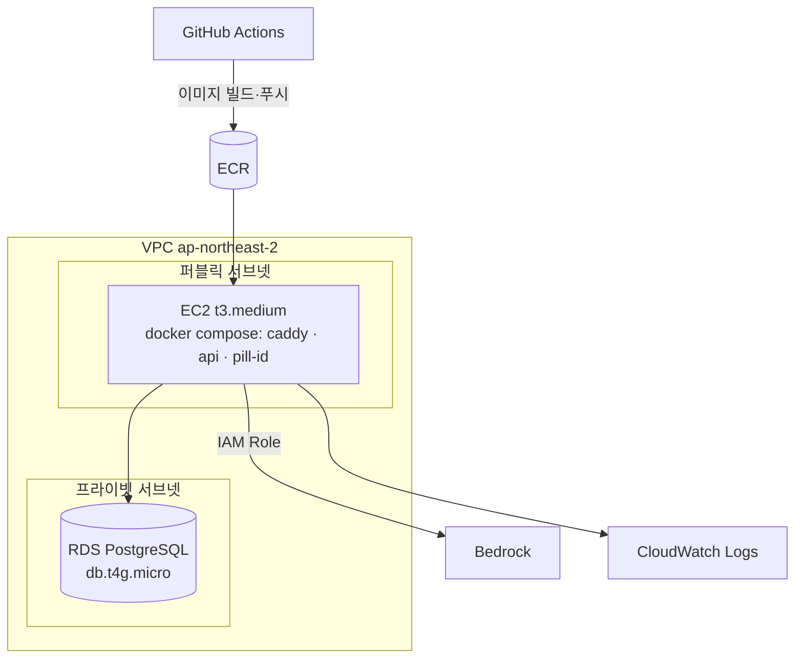
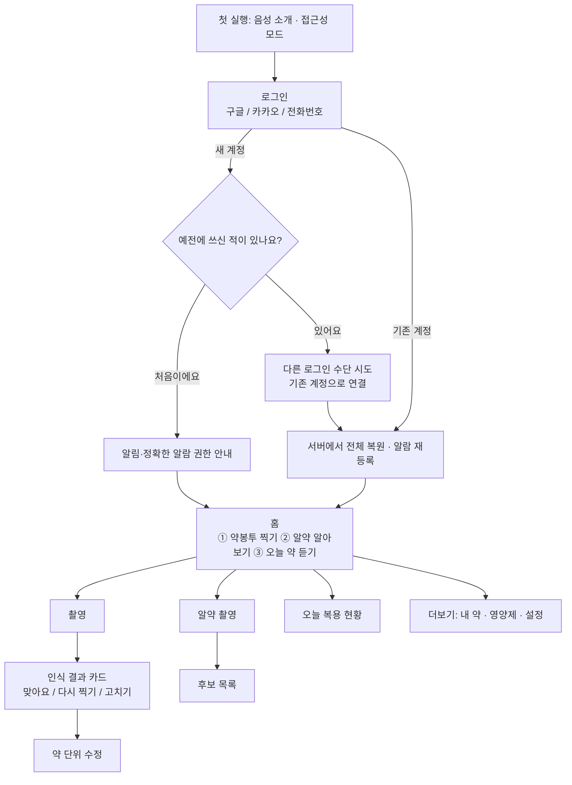
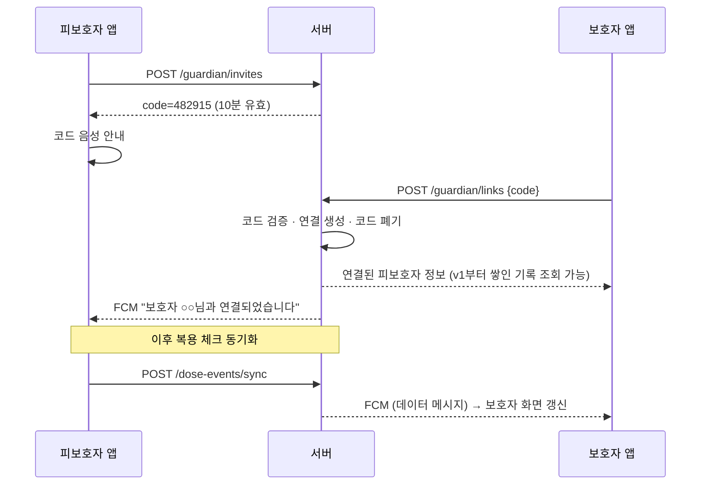

# MediMate 기술 설계서

| 항목 | 내용 |
|---|---|
| 버전 | v1.0 (2026-09-27) |
| 관련 문서 | [요구사항 정의서](01_요구사항정의서.md), [AI·OCR 연동 설계서](03_AI_OCR_연동설계서.md), [API 명세서](04_API명세서.md) |

---

## 1. 설계 원칙

1. **안전 우선** – AI 결과는 "제안"이다. 원문 근거 검증, 공공 DB 대조, 사용자 확인 없이 확정하지 않는다. 음성 문장은 AI가 아니라 서버 템플릿이 만든다.
2. **비밀 정보는 서버에만** – 앱은 자체 백엔드만 호출한다. CLOVA·Bedrock·공공데이터 키는 앱에 들어가지 않는다.
3. **알림은 기기에서** – 복약 알림은 네트워크와 무관하게 기기 로컬 알람으로 울린다. 서버는 기록 보관과 복원을 맡는다(보호자 통지는 v2).
4. **오프라인 우선 조회** – 약 목록·일정·복용 기록은 Room에 있고, 서버와는 동기화한다.
5. **설정으로 교체 가능** – 모델 ID, 리전, effort, 프롬프트 버전, 임계값은 설정 파일로 관리한다.

---

## 2. 시스템 아키텍처



### 2.1 구성 요소 책임

| 구성 요소 | 책임 |
|---|---|
| Android 앱 | 촬영 가이드, 이미지 축소·업로드, 결과 표시·낭독, 로컬 알람, 복용 체크, 오프라인 저장, 동기화 |
| Spring Boot API | 인증, 인식 작업 오케스트레이션(OCR → 마스킹 → AI → 검증 → 음성 문장), 약·일정·복용 관리와 동기화, 공공데이터 적재 |
| pill-id 서비스 | 기존 `pill-classifier`를 FastAPI로 감싼 내부 서비스. 알약 분할·모양·색·각인·임베딩 점수로 후보 Top-K 계산 |
| PostgreSQL | 서버 기준 데이터, 식약처 품목 캐시(`pg_trgm` 유사 검색) |
| Bedrock (Claude Fable 5.1) | OCR 정제·구조화, 알약 비전 관찰·재순위, 영양제 설명문 |
| CLOVA OCR | 약봉투·처방전 텍스트와 좌표 인식 |
| Google / Kakao | 소셜 로그인. 앱이 받은 ID 토큰을 서버가 검증해 자체 계정과 연결 |
| NAVER Cloud SENS | 전화번호 로그인 인증번호 SMS 발송 |
| Firebase | **v1에서는 사용하지 않음.** v2 보호자 기능에서 FCM 푸시만 도입(§14) |

---

## 3. 기술 스택

| 영역 | 선택 | 비고 |
|---|---|---|
| 앱 언어/UI | **Java 17**, XML View + Material Components | 현재 프로젝트(`com.medimate`, minSdk 26)가 Java·View 기반이므로 유지. View 시스템이 TalkBack 속성 제어가 명확함 |
| 앱 구조 | MVVM (ViewModel + LiveData), Repository | |
| 앱 라이브러리 | CameraX, Room, Retrofit2 + OkHttp + Moshi, WorkManager, Android `TextToSpeech` | v2에서 Firebase Messaging 추가 |
| 앱 로그인 | Credential Manager + Google ID 라이브러리(Google), Kakao SDK v2 `user` 모듈(카카오), SMS Retriever API(인증번호 자동 입력) | |
| 서버 | **Java 21, Spring Boot 3.x** (Web, Validation, Data JPA, Security, OAuth2 Resource Server, Actuator) | 가상 스레드로 외부 API 대기 처리 |
| AI SDK | `anthropic-java` + Bedrock 백엔드(Mantle) | 03 문서 §3 |
| OCR 호출 | Spring `RestClient` | CLOVA는 REST |
| DB | PostgreSQL 16 + Flyway, `pg_trgm` | 약품명 유사 검색 |
| 캐시 | Caffeine (인메모리) | 단일 인스턴스 기준 |
| 알약 식별 | Python 3.11, FastAPI, 기존 `pill-classifier`(OpenCV, RapidOCR/EasyOCR, PyTorch) | CPU 추론 |
| 인프라 | AWS EC2(t3.medium) + Docker Compose, RDS 또는 컨테이너 PostgreSQL, SSM Parameter Store, CloudWatch Logs | |
| CI | GitHub Actions (빌드·테스트, Docker 이미지 빌드) | |

---

## 4. 백엔드 모듈 설계

### 4.1 패키지 구조

```
com.medimate.server
 ├─ auth/            로그인(Google·카카오·전화번호), ID 토큰 검증, JWT 발급·검증, 갱신 토큰, 계정 연결
 │   ├─ OidcIdTokenVerifier   Google·카카오 공통 (JWKS 서명·iss·aud·exp 검증)
 │   ├─ PhoneOtpService       인증번호 생성·발송(SENS)·확인·횟수 제한
 │   └─ TokenService          액세스 JWT 발급, 갱신 토큰 회전·재사용 감지
 ├─ user/            사용자, 설정, 건강 프로필
 ├─ scan/            인식 작업(약봉투·처방전·알약) 오케스트레이션
 │   ├─ ScanService, ScanJobRunner
 │   ├─ bag/         BagPipeline (OCR → 마스킹 → AI → 검증)
 │   └─ pill/        PillPipeline (pill-id + Claude 비전)
 ├─ ocr/             ClovaOcrClient, OcrResult 모델, 줄 재구성
 ├─ ai/              ClaudeClient(Bedrock), 프롬프트 로더, 스키마, 응답 검증
 ├─ drug/            식약처 품목·낱알·e약은요·DUR 적재와 조회, 약품명 매칭
 ├─ medication/      약, 복약 일정, 복용 이벤트, 동기화
 ├─ supplement/      영양제 추천 규칙 엔진 + 설명 생성
 ├─ speech/          음성 안내 문장 템플릿(숫자·단위 읽기 규칙)
 └─ common/          오류 코드, 예외 처리, 요청 ID, 사용량 제한
```

v2에서 `guardian/`(초대 코드, 연결, 권한 검사, 미복용 감지)와 `notify/`(FCM 발송)가 추가된다(§14).

### 4.2 인식 작업(Scan) 흐름

인식은 수 초~수십 초가 걸리므로 **비동기 작업**으로 처리한다.



- 작업 실행기: `Executors.newVirtualThreadPerTaskExecutor()` + 동시 실행 제한(`Semaphore`, 기본 8)으로 외부 API 과부하 방지.
- 상태: `PROCESSING → NEEDS_CONFIRM → CONFIRMED` / `FAILED`. 서버 재시작 시 2분 이상 `PROCESSING`인 작업은 `FAILED(SERVER_RESTARTED)`로 정리.
- 단계별 소요 시간·토큰 수를 `scans` 행에 기록한다(비용·성능 분석용).

### 4.3 알약 식별 (pill-id 서비스 연동)

기존 `pill-classifier`의 `PillIdentifier`를 FastAPI로 감싸 내부 서비스로 운영한다. Spring은 Claude 비전 관찰 결과를 **힌트**로 함께 넘겨 각인 인식 약점을 보완한다(상세: 03 문서 §6).



`pill-classifier` 쪽 추가 작업:

| 작업 | 내용 |
|---|---|
| `service/app.py` | FastAPI 앱. 기동 시 `PillIdentifier` 1회 로드, `POST /identify`, `GET /health` |
| 힌트 반영 | `identify(obs, hints=...)`: Claude 각인 텍스트를 `canonical_imprint`로 정규화해 각인 OCR(RapidOCR 기본, EasyOCR 대체) 결과와 함께 점수화(두 값 중 높은 점수 사용). Claude 모양·색은 이미지 추정치와 평균 |
| 복용 약 가산 | `boost_item_seqs`에 든 품목은 점수에 +0.05 (설정값) |
| 자원 | 각인 OCR + 임베딩 모델 상주 메모리 약 1.5–2GB → EC2 t3.medium(4GB) 이상 |
| DB 공유 | 낱알식별 SQLite는 pill-id가 소유. Spring은 품목 상세를 PostgreSQL `drug_products`에서 조회 |

### 4.4 약품 데이터 적재

| 데이터 | 적재 방식 | 주기 |
|---|---|---|
| 낱알식별 정보 (약 2.5만) | `pill-classifier/scripts/build_db.py` → SQLite + 참조 이미지. Spring은 같은 API로 `drug_pill_ids` 테이블에도 적재 | 월 1회 |
| 의약품 제품 허가정보 | 전체 적재 → `drug_products` (품목명, 업체, 성분, 전문/일반) | 월 1회 |
| e약은요 | 품목 조회 시 지연 적재 후 캐시(`drug_easy_info`) | 30일 만료 |
| DUR 병용금기 | 성분 쌍 전체 적재 → `dur_interactions` | 월 1회 |
| 건강기능식품 기능성 원료 | 전체 적재 → `supplement_ingredients` | 분기 1회 |

- 공공데이터 API 서비스명·버전(예: `MdcinGrnIdntfcInfoService03`)은 개정되므로 착수 시 data.go.kr에서 확인한다.
- 약품명 매칭: 정규화(공백·괄호·"(수출명)" 제거, 함량 표기 통일) 후 `pg_trgm` `similarity()` 상위 5개 → 함량·업체 일치로 재정렬(03 §5.3).

### 4.5 영양제 추천

규칙 엔진이 **안전 판단**을, Claude는 **설명**만 맡는다.



- 상호작용 규칙표(`supplement_drug_rules`)는 팀이 공개 자료(식약처 건강기능식품 섭취 주의 자료 등)를 근거로 작성하고 출처 열을 둔다. 표에 없는 조합은 "정보 없음"으로 안내하며 추천 근거로 쓰지 않는다.
- 초기 규칙 예: 와파린 ↔ 비타민K·오메가3·은행잎 추출물, 레보티록신 ↔ 칼슘·철(복용 간격), 스타틴 ↔ 홍국, 항혈소판제 ↔ 오메가3.

---

## 5. 복약 알림 설계

### 5.1 역할 분담

| 주체 | 역할 |
|---|---|
| 기기 (주) | 일정 규칙으로 다음 알람들을 계산해 `AlarmManager`에 등록. 알람 수신 → 알림 + TTS. 복용 체크 로컬 기록 |
| 서버 (보조) | 같은 규칙으로 복용 이벤트를 만들어 보관(기록 조회, 재설치·기기 변경 복원용). v1에서는 서버가 기기로 알림을 보내지 않는다. 보호자 푸시·백업 알림은 v2(§14) |

### 5.2 기기 알람

- 등록: 앞으로 48시간 이내 알람만 등록하고, 알람이 울릴 때마다 다음 구간을 다시 계산(등록 수 제한 회피).
- API: 정확한 알람 권한이 있으면 `setAlarmClock()`(도즈 모드 예외), 없으면 `setAndAllowWhileIdle()`(도즈 모드에서 수 분 늦어질 수 있음) + 홈 화면 경고와 설정 바로가기(FR-SCHED-08). 권한 상태는 앱 시작 때마다 다시 확인한다.
- 권한: `POST_NOTIFICATIONS`(API 33+), `SCHEDULE_EXACT_ALARM`(API 31+, 사용자 허용 필요 – 온보딩에서 음성으로 설정 화면 안내). `USE_EXACT_ALARM`은 Play 정책상 알람·캘린더 앱 전용이라 사용하지 않는다.
- 재등록 트리거: `BOOT_COMPLETED`, `TIME_SET`, `TIMEZONE_CHANGED`, `MY_PACKAGE_REPLACED`, 일정 변경 시.
- 알람 수신: 같은 시각 약을 한 알림으로 묶음 → 알림 채널(높은 중요도, 소리·진동) + TTS 낭독. 알림 액션 "먹었어요"는 `BroadcastReceiver`에서 Room에 기록 후 동기화 작업 예약.
- 배터리 최적화: 삼성·샤오미 등 제조사 절전 정책 대응으로 "배터리 사용량 최적화 제외" 설정 안내 화면 제공.
- 재알림: 15분 간격 최대 2회(설정 가능).

### 5.3 복용 이벤트 ID 규칙
기기와 서버가 따로 이벤트를 만들어도 충돌하지 않도록 **결정적 키** `(schedule_id, scheduled_at)`를 쓴다. 오프라인 체크는 이 키로 서버에 upsert한다.

### 5.4 서버 스케줄러

| 작업 | 주기 | 내용 |
|---|---|---|
| `DoseEventGenerator` | 매일 00:05 + 일정 변경 시 | 향후 3일치 이벤트 생성(멱등) |
| `MissedDoseMarker` | 10분마다 | `status=PENDING AND scheduled_at + 2시간 < now()`인 이벤트 → `MISSED` 표시(기록용). v2에서 보호자 통지용 `MissedDoseDetector`로 확장(§14) |

- 복용 종료 하루 전 안내(FR-SCHED-05)는 기기가 일정의 `end_date`를 보고 로컬 알림으로 띄운다.

- 시간대는 `Asia/Seoul` 고정, DB에는 `timestamptz`로 저장.
- 단일 인스턴스 운영을 전제로 `@Scheduled`를 사용한다. 인스턴스를 늘리면 ShedLock을 추가한다.

---

## 6. 보호자 연결·동기화 – v2로 이동

보호자 기능은 v1에서 제외했다. 설계는 §14에 있다.

---

## 7. 데이터 설계

### 7.1 ERD



### 7.2 주요 테이블 (PostgreSQL)

```sql
CREATE TABLE users (
  id               BIGSERIAL PRIMARY KEY,
  display_name     VARCHAR(50),
  access_mode      VARCHAR(20) NOT NULL DEFAULT 'STANDARD',     -- VOICE, LARGE_TEXT, STANDARD
  tts_rate         NUMERIC(2,1) NOT NULL DEFAULT 1.0,
  meal_times       JSONB NOT NULL DEFAULT '{"MORNING":"08:00","LUNCH":"12:30","EVENING":"18:30","BEDTIME":"22:00"}',
  consents         JSONB NOT NULL DEFAULT '{}',  -- {"sensitive":"2026-09-27T..","overseas":..,"photoRetention":..}
  daily_scan_limit INT NOT NULL DEFAULT 30,
  created_at       TIMESTAMPTZ NOT NULL DEFAULT now(),
  deleted_at       TIMESTAMPTZ
);

-- 로그인 수단: 한 사용자에 여러 개 연결 가능 (FR-AUTH-07)
CREATE TABLE user_identities (
  id            BIGSERIAL PRIMARY KEY,
  user_id       BIGINT NOT NULL REFERENCES users(id) ON DELETE CASCADE,
  provider      VARCHAR(10) NOT NULL,     -- GOOGLE, KAKAO, PHONE
  subject       VARCHAR(128) NOT NULL,    -- Google/카카오: ID 토큰 sub, 전화번호: HMAC-SHA256(E.164)
  phone_enc     BYTEA,                    -- 전화번호 AES-GCM 암호문 (PHONE만)
  email         VARCHAR(320),             -- Google만, 표시용 (선택)
  created_at    TIMESTAMPTZ NOT NULL DEFAULT now(),
  last_login_at TIMESTAMPTZ,
  UNIQUE (provider, subject)
);
CREATE INDEX ON user_identities (user_id);

-- 갱신 토큰: 원문은 저장하지 않고 해시만. 사용 시 회전, 재사용 감지 시 family 전체 폐기
CREATE TABLE refresh_tokens (
  token_hash   CHAR(64) PRIMARY KEY,      -- SHA-256
  user_id      BIGINT NOT NULL REFERENCES users(id) ON DELETE CASCADE,
  family_id    UUID NOT NULL,             -- 같은 로그인에서 이어진 토큰 묶음
  device_name  VARCHAR(100),
  expires_at   TIMESTAMPTZ NOT NULL,
  used_at      TIMESTAMPTZ,
  revoked_at   TIMESTAMPTZ
);
CREATE INDEX ON refresh_tokens (user_id);

CREATE TABLE phone_otps (
  id           BIGSERIAL PRIMARY KEY,
  phone_hash   CHAR(64) NOT NULL,         -- HMAC-SHA256(E.164)
  code_hash    CHAR(64) NOT NULL,         -- HMAC-SHA256(인증번호)
  expires_at   TIMESTAMPTZ NOT NULL,      -- 발송 + 3분
  attempts     SMALLINT NOT NULL DEFAULT 0,
  verified_at  TIMESTAMPTZ,
  request_ip   INET,
  created_at   TIMESTAMPTZ NOT NULL DEFAULT now()
);
CREATE INDEX ON phone_otps (phone_hash, created_at DESC);

CREATE TABLE health_profiles (
  user_id     BIGINT PRIMARY KEY REFERENCES users(id) ON DELETE CASCADE,
  birth_year  SMALLINT,
  sex         VARCHAR(1),
  conditions  VARCHAR(40)[],  -- 코드: HYPERTENSION, DIABETES ...
  allergies   TEXT[],
  pregnant    BOOLEAN,
  updated_at  TIMESTAMPTZ NOT NULL DEFAULT now()
);

CREATE TABLE scans (
  id             UUID PRIMARY KEY,
  user_id        BIGINT NOT NULL REFERENCES users(id),
  kind           VARCHAR(20) NOT NULL,   -- MEDICATION_BAG, PRESCRIPTION, PILL
  status         VARCHAR(20) NOT NULL,   -- PROCESSING, NEEDS_CONFIRM, CONFIRMED, FAILED
  error_code     VARCHAR(40),
  ocr_result     JSONB,                  -- 마스킹된 줄 텍스트 + 신뢰도 (원본 이미지 없음)
  ai_result      JSONB,                  -- 검증 후 구조화 결과
  result_view    JSONB,                  -- 앱에 내려주는 결과 + speech[]
  model_id       VARCHAR(80),
  prompt_version VARCHAR(20),
  input_tokens   INT, output_tokens INT,
  timings_ms     JSONB,                  -- {"ocr":1200,"ai":6400,"validate":80}
  image_key      VARCHAR(200),           -- 사진 보관 동의 시에만
  created_at     TIMESTAMPTZ NOT NULL DEFAULT now()
);
CREATE INDEX ON scans (user_id, created_at DESC);

CREATE TABLE drug_products (
  item_seq     VARCHAR(20) PRIMARY KEY,  -- 식약처 품목기준코드
  item_name    VARCHAR(300) NOT NULL,
  name_norm    VARCHAR(300) NOT NULL,    -- 정규화 이름 (검색용)
  entp_name    VARCHAR(200),
  etc_otc      VARCHAR(10),              -- 전문/일반
  ingredients  JSONB,                    -- [{"name":"아세트아미노펜","amount":"500","unit":"mg"}]
  updated_at   TIMESTAMPTZ NOT NULL
);
CREATE EXTENSION IF NOT EXISTS pg_trgm;
CREATE INDEX drug_products_name_trgm ON drug_products USING gin (name_norm gin_trgm_ops);

CREATE TABLE drug_easy_info (
  item_seq    VARCHAR(20) PRIMARY KEY REFERENCES drug_products(item_seq),
  efficacy    TEXT, usage TEXT, warning TEXT, caution TEXT,
  interaction TEXT, side_effect TEXT, storage TEXT,
  source_date DATE, fetched_at TIMESTAMPTZ NOT NULL
);

CREATE TABLE medications (
  id             BIGSERIAL PRIMARY KEY,
  user_id        BIGINT NOT NULL REFERENCES users(id),
  scan_id        UUID REFERENCES scans(id),
  item_seq       VARCHAR(20) REFERENCES drug_products(item_seq),  -- 매칭 실패 시 NULL
  display_name   VARCHAR(200) NOT NULL,
  strength       VARCHAR(50),
  dose_amount    NUMERIC(5,2) NOT NULL,    -- 0.5 = 반 알
  dose_unit      VARCHAR(10) NOT NULL,     -- 정, 캡슐, 포, mL
  meal_relation  VARCHAR(20),              -- BEFORE_MEAL, AFTER_MEAL, WITH_MEAL, ANY
  meal_offset_min SMALLINT,                -- 식후 30분 → 30
  start_date     DATE NOT NULL,
  end_date       DATE,                     -- 총 일수로 계산, 상시 복용은 NULL
  needs_review   BOOLEAN NOT NULL DEFAULT false,
  active         BOOLEAN NOT NULL DEFAULT true,
  created_at     TIMESTAMPTZ NOT NULL DEFAULT now(),
  updated_at     TIMESTAMPTZ NOT NULL DEFAULT now()
);

CREATE TABLE medication_schedules (
  id             BIGSERIAL PRIMARY KEY,
  medication_id  BIGINT NOT NULL REFERENCES medications(id) ON DELETE CASCADE,
  slot           VARCHAR(10) NOT NULL,     -- MORNING, LUNCH, EVENING, BEDTIME, CUSTOM
  time_of_day    TIME NOT NULL,
  days_of_week   SMALLINT NOT NULL DEFAULT 127  -- 비트마스크 (월=1 … 일=64)
);

CREATE TABLE dose_events (
  schedule_id    BIGINT NOT NULL REFERENCES medication_schedules(id) ON DELETE CASCADE,
  scheduled_at   TIMESTAMPTZ NOT NULL,
  user_id        BIGINT NOT NULL REFERENCES users(id),
  status         VARCHAR(10) NOT NULL DEFAULT 'PENDING',  -- PENDING, TAKEN, SKIPPED, MISSED
  taken_at       TIMESTAMPTZ,
  recorded_by    VARCHAR(10),                              -- APP (v2: GUARDIAN 추가)
  updated_at     TIMESTAMPTZ NOT NULL DEFAULT now(),
  PRIMARY KEY (schedule_id, scheduled_at)
);
CREATE INDEX dose_events_pending ON dose_events (scheduled_at) WHERE status = 'PENDING';
```

v2에서 추가되는 테이블·컬럼(`guardian_links`, `guardian_invites`, `devices`, `users.roles`, `dose_events.guardian_notified_at`)은 §14.3에 있다. Flyway 마이그레이션으로 추가하므로 v1 스키마를 바꿀 필요는 없다.

그 밖의 테이블: `drug_pill_ids`(낱알식별 속성), `dur_interactions`(성분 쌍), `supplement_ingredients`, `supplement_drug_rules`(성분 × 원료, 등급, 사유, 출처), `supplement_recommendations`(입력 스냅샷·결과), `usage_daily`(사용자별 일일 인식 횟수·토큰).

### 7.3 앱 로컬 DB (Room)

| 엔티티 | 용도 |
|---|---|
| `MedicationEntity`, `ScheduleEntity` | 서버와 같은 구조, `serverId`·`updatedAt`으로 동기화 |
| `DoseEventEntity` | `(scheduleId, scheduledAt)` 키, `syncState`(SYNCED / DIRTY) |
| `DrugInfoEntity` | 등록 약의 e약은요 요약 캐시(오프라인 낭독용) |
| `PendingOpEntity` | 오프라인 중 생긴 변경 큐 |

재설치·기기 변경 복원(FR-AUTH-06): 로그인 직후 Room이 비어 있으면 `GET /sync`(since 없음)로 전체를 받아 저장하고 알람을 다시 등록한다. 서버가 원본이므로 로컬 DB는 언제든 버리고 다시 받을 수 있다.

동기화: 앱 시작·네트워크 복구·복용 체크 시 `WorkManager` 작업 실행 → DIRTY 이벤트 일괄 업로드(`POST /dose-events/sync`) → 서버 변경분 수신(`GET /sync?since=`). 충돌 시 복용 기록은 **TAKEN 우선**, 약·일정은 `updatedAt`이 늦은 쪽 우선.

---

## 8. 보안·개인정보

### 8.1 인증·계정 설계

로그인 수단은 **Google, 카카오, 전화번호(SMS)** 세 가지다. 어떤 수단이든 서버는 결국 자체 계정(`users`)에 연결하고 **자체 토큰**을 발급한다. 앱을 지워도 계정과 데이터는 서버에 남으므로, 같은 수단으로 다시 로그인하면 복원된다(FR-AUTH-06).

**Google·카카오 로그인**



| 항목 | Google | 카카오 |
|---|---|---|
| 앱 SDK | Credential Manager + Google ID 라이브러리 (`GetGoogleIdOption`, `serverClientId` = 웹 클라이언트 ID) | Kakao SDK v2 `user` 모듈. 카카오톡 앱이 있으면 앱으로, 없으면 카카오 계정 웹 로그인 |
| 받는 값 | Google ID 토큰 | OpenID Connect ID 토큰 (카카오 개발자 콘솔에서 **OpenID Connect 활성화** 필요) |
| 서버 검증 | JWKS `https://www.googleapis.com/oauth2/v3/certs`, iss `https://accounts.google.com`, aud = 웹 클라이언트 ID | JWKS `https://kauth.kakao.com/.well-known/jwks.json`, iss `https://kauth.kakao.com`, aud = 카카오 앱 키 (**값은 콘솔에서 확인**) |
| 계정 키 | `sub` | `sub` (카카오 회원번호) |
| 콘솔 등록 | Android OAuth 클라이언트: 패키지명 + **디버그·업로드·Play 앱 서명 키 SHA-1** | Android 플랫폼: 패키지명 + **디버그·릴리스·Play 앱 서명 키 해시** |
| 동의 항목 | 기본(이메일은 표시용, 선택) | 추가 동의 항목 없음(회원번호만 사용) |

서버의 `OidcIdTokenVerifier` 하나가 설정값(JWKS URL, iss, aud)만 바꿔 두 제공자를 모두 검증한다(Spring Security의 `NimbusJwtDecoder` 사용, JWKS는 캐시).

**전화번호 로그인**



- 인증번호: 6자리, 3분 유효, 확인 5회까지. 재발송 60초 후, 번호당 하루 5회, IP당 하루 20회.
- SMS Retriever API: 권한 없이 앱 해시(11자)가 든 문자만 자동으로 읽는다. 문자 형식은 API 규격에 맞춘다. 자동 인식이 안 되면 큰 숫자 키패드로 입력.
- 저장: 번호는 `HMAC-SHA256`(조회용)과 `AES-GCM` 암호문(발송·표시용)으로만 저장한다. 두 키는 SSM에 둔다.
- SENS 준비: 문자 발신번호 **사전 등록**(통신서비스 이용증명원 등 서류 심사)이 필요하므로 1–2주차에 신청한다. 건당 요금은 콘솔에서 확인.
- Play 심사용: 설정의 테스트 번호 1개에만 고정 인증번호를 허용한다(운영 설정에서 다른 번호에는 적용 안 됨).

**자체 토큰**

| 토큰 | 형식 | 수명 | 저장 |
|---|---|---|---|
| 액세스 토큰 | JWT (ES256, `sub`=userId, `kid`; v2에서 `roles` 추가) | 30분 | 앱 메모리 |
| 갱신 토큰 | 무작위 256비트 | 90일, 사용할 때마다 회전하며 연장 | 앱: Android Keystore 키로 암호화해 저장, **자동 백업 제외**(`data_extraction_rules.xml`, `backup_rules.xml`) / 서버: SHA-256 해시 |

- 앱은 401을 받으면 `POST /auth/refresh`로 새 토큰 쌍을 받아 원래 요청을 한 번 다시 보낸다. 사용자가 로그아웃하지 않으면 계속 로그인 상태가 유지된다(FR-AUTH-09).
- 이미 쓴 갱신 토큰이 다시 오면 탈취로 보고 그 `family_id` 전체를 폐기한다 → 해당 기기는 다시 로그인.
- JWT 서명 키는 SSM에 두고 `kid`로 교체할 수 있게 한다.

**계정 연결과 빈 계정 정리 (FR-AUTH-07, 10)**

| 상황 | 처리 |
|---|---|
| 로그인한 수단이 처음 보는 것 | 새 계정 생성, `isNewUser=true` |
| 설정에서 수단 추가 → 아무 계정에도 없는 수단 | 현재 계정에 연결 |
| 추가하려는 수단이 **다른 계정**에 있고, 현재 계정이 비어 있음(약·복용 기록·인식 기록 없음) | 현재 계정의 수단들을 기존 계정으로 옮기고 빈 계정 삭제 → 기존 계정 토큰 발급. 다음부터는 두 수단 모두로 기존 계정에 로그인됨 |
| 추가하려는 수단이 다른 계정에 있고, 현재 계정에도 데이터가 있음 | `409 AUTH_IDENTITY_IN_USE`. 데이터가 있는 두 계정의 병합은 범위 밖(필요 시 수동 처리) |
| 마지막 남은 수단 해제 | 거부 |

첫 로그인에서 "예전에 쓰신 적 있어요"를 고르면 앱은 위의 "수단 추가" 흐름으로 다른 두 수단을 시도하게 한다.

### 8.2 보안 항목

| 항목 | 설계 |
|---|---|
| 인증 | §8.1. 모든 API는 자체 액세스 토큰(`Authorization: Bearer`)으로 인증, Spring Security OAuth2 Resource Server로 검증 |
| 인가 | 모든 리소스는 소유자 검사(v1은 본인 데이터만 접근). 보호자 권한 검사는 v2(§14) |
| 전송 | Caddy 자동 TLS(Let's Encrypt), HSTS |
| 비밀 정보 | CLOVA 시크릿, SENS 키, 공공데이터 키, JWT 서명 키, 전화번호 암호화·HMAC 키(v2: FCM 서비스 계정 키 추가): SSM Parameter Store(SecureString). Bedrock: EC2 인스턴스 IAM Role(액세스 키 사용 안 함) |
| AI 전송 데이터 최소화 | OCR 텍스트에서 주민등록번호·전화번호·환자명·처방전 교부번호를 정규식으로 마스킹 후 Claude로 전송(03 §4.2). 알약 사진에는 개인정보가 없음 |
| 이미지 | 기본 비저장(메모리에서 처리 후 폐기). 보관 동의 시 S3 SSE 암호화, 30일 수명 주기 삭제 |
| 로그 | 요청 ID, 사용자 ID 해시, 단계별 시간, 토큰 수, 오류 코드만 기록. 본문·OCR 텍스트 로그 금지 |
| 남용 방지 | 사용자별 일일 인식 상한, IP·사용자별 속도 제한(Bucket4j), 인증번호 발송·확인 제한(§8.1), 업로드 10MB 제한, 이미지 형식 매직 바이트 검사 |
| 동의 | 필수(서비스 이용), 민감정보(건강 정보), 개인정보 처리 위탁(NAVER Cloud, AWS), 국외 이전(Bedrock 리전이 국외인 경우), 선택(사진 보관) 분리 |
| 삭제 | 계정 삭제 시 사용자 데이터 즉시 삭제, 백업은 7일 내 순환 삭제 |

---

## 9. 배포·인프라



- 환경: `local`(docker compose 전체), `prod`(EC2). 스테이징은 비용상 두지 않고 Play 비공개 테스트 트랙으로 대신한다.
- 비용 절감안: RDS 대신 EC2 내 PostgreSQL 컨테이너 + 매일 `pg_dump` → S3 백업(예산이 빠듯할 때).
- Bedrock 리전: Claude Fable 5.1이 서울 리전에 없으면 제공 리전(또는 교차 리전 추론 프로파일)을 `medimate.ai.bedrock.region`으로 지정한다. 이 경우 국외 이전 동의가 필요하다.
- 배포: `main` 브랜치 태그 → 이미지 빌드 → EC2에서 `docker compose pull && up -d`. Flyway가 기동 시 마이그레이션.

---

## 10. 오류 처리·복원력

| 외부 호출 | 타임아웃 | 재시도 | 실패 시 |
|---|---|---|---|
| CLOVA OCR | 연결 3초 / 응답 15초 | 5xx·타임아웃 1회 (지수 백오프) | `OCR_UNAVAILABLE` |
| Bedrock Claude | 응답 40초 | 429·5xx·타임아웃 1회 | `AI_UNAVAILABLE`, 거절 시 `AI_REFUSED` (03 §3.5) |
| pill-id | 20초 | 없음 | 비전 관찰만으로 DB 검색(축소 모드) |
| 식약처 API | 5초 | 2회 | 캐시 사용, 없으면 "정보를 불러오지 못했습니다" |
| NCP SENS | 5초 | 1회 | `AUTH_OTP_SEND_FAILED` → "문자를 보내지 못했습니다. 다른 로그인 방법을 쓰시거나 잠시 후 다시 시도해 주세요." |

- 오류 응답에는 `speechMessage`(음성용 문장)를 포함해 앱이 그대로 읽는다(04 §1.4).
- 전체 인식 작업에는 25초 상한(NFR-PERF-01)을 두고 넘으면 진행 중 단계를 취소한다.

---

## 11. 관측·운영

- Spring Actuator 헬스체크, Micrometer 지표 → CloudWatch.
- 핵심 지표: 인식 성공률, 단계별 p50/p95, 사용자 확인 시 수정 비율(= AI 오류 대리 지표), `needs_review` 비율, 요청당 토큰·비용, 정확한 알람 권한 허용률(기기에서 동기화 시 함께 보고), 로그인 수단별 가입 수.
- 알람: 인식 실패율 20% 초과(10분), Bedrock 오류 연속 5회, 디스크 80%.
- 주간 활동보고서에 비용·품질 지표를 첨부한다.

---

## 12. Android 앱 설계

### 12.1 화면 구조 (최소 깊이)



- 홈은 버튼 3개만, 세로 한 줄 배치. 모든 화면 상단에 "다시 듣기".
- 패키지: `ui/`(Activity·Fragment), `viewmodel/`, `data/`(Repository, Room, Retrofit), `alarm/`, `camera/`, `speech/`, `sync/`.

### 12.2 촬영 가이드
- CameraX `ImageAnalysis`로 프레임마다 밝기(평균 휘도)와 흐림(라플라시안 분산) 계산 → 조건 미달 시 1.5초 간격 음성·진동 안내.
- 약봉투: 문서 윤곽(가장 큰 사각형) 검출로 "조금 더 멀리 / 왼쪽으로" 안내, 조건 충족 1초 유지 시 자동 촬영.
- 알약: 어두운 바탕 안내, 중앙 원형 가이드, 앞면 → 뒷면 순서 음성 안내.
- 업로드 전 긴 변 2,000px, JPEG 85, EXIF 제거.

### 12.3 음성(TTS)
- `TextToSpeech`(ko-KR). 서버가 준 `speech[]` 문장을 순서대로 큐에 넣어 읽음. TalkBack 켜짐 상태에서는 결과 화면 진입 시 자동 낭독 대신 `announceForAccessibility`로 요약 1문장만 알리고, 나머지는 "다시 듣기"로 제공(스크린 리더 음성과 겹침 방지).
- 기기에 한국어 음성 데이터가 없으면 설치 화면으로 안내.

### 12.4 접근성 체크리스트
- 모든 버튼 `contentDescription`, 장식 이미지 `importantForAccessibility="no"`.
- 글자 단위 `sp`, 큰 글씨 모드 테마 오버레이(24sp 이상, 고대비 색).
- 터치 영역 64dp 이상, 버튼 간격 16dp 이상.
- 상태 변화 `announceForAccessibility` + 진동 패턴(성공: 짧게 1회, 오류: 길게 2회).
- Espresso + Accessibility Test Framework로 CI에서 자동 검사.

---

## 13. 설계 결정 기록 (ADR)

| # | 결정 | 이유 | 대안 |
|---|---|---|---|
| ADR-1 | OCR은 CLOVA General 프리미엄 | 한국어 인쇄물·작은 글씨·표 형태 인식이 강함, 서버에서 호출해 키 보호 | ML Kit(기기 내, 무료지만 한국어 소형 글씨 정확도 열세) |
| ADR-2 | AI는 Bedrock의 Claude Fable 5.1 | 구조화 출력(JSON Schema)과 비전 입력을 한 모델로 처리, IAM 기반 인증으로 키 관리 불필요. Fable 5와 같은 가격의 후속 모델 | 기획안의 ChatGPT 3.5(구조화·비전 성능과 장기 지원 한계), Claude Fable 5(이전 세대) |
| ADR-3 | 음성 문장은 서버 템플릿 생성 | 청각 정보는 되돌려 확인하기 어려워 환각 위험이 큼 | AI가 낭독문 생성 |
| ADR-4 | 알림은 기기 로컬 알람이 주 경로 | 네트워크·서버 장애와 무관, 지연 없음 | 서버 FCM 푸시(도즈 모드·네트워크 영향) |
| ADR-5 | 서버 DB는 PostgreSQL. v1은 Firebase를 쓰지 않고, v2에서 FCM 푸시만 도입 | 관계형 일정·권한 질의, `pg_trgm` 약품명 검색, 데이터 원천 일원화. v1에는 서버→기기 알림이 필요 없음. v2 보호자 푸시는 앱이 꺼져 있어도 도착해야 하는데 안드로이드에서는 FCM이 사실상 유일 | Firestore 병행(데이터 원천이 둘로 나뉨), 상시 소켓 연결(절전 모드에서 끊김) |
| ADR-6 | 알약 식별은 기존 pill-classifier + Claude 비전 결합 | 공공 DB 기반 후보 탐색은 결정적·설명 가능, Claude는 각인 판독과 최종 비교에 강함 | Claude 단독(2.5만 품목 대조 불가), CV 단독(각인 OCR 약함) |
| ADR-7 | 인식은 비동기 작업 + 롱폴링 | 모바일 네트워크에서 긴 HTTP 요청 끊김 방지, 진행음 제공 용이 | 동기 요청, WebSocket |
| ADR-8 | 로그인은 Google·카카오·전화번호 3종, 토큰은 서버 자체 발급 | 재설치·기기 변경 후에도 계정 복원 필요, 고령층이 이미 쓰는 계정(카카오톡·구글)과 계정이 없는 사람을 위한 전화번호를 함께 지원, 인증 체계를 서버 하나로 통일 | Firebase Auth(서버 인증과 이원화), 기기 ID 기반 자동 계정(재설치 시 유실·기기 변경 불가) |
| ADR-9 | 보호자 기능은 v2로 분리 | 학기 내 v1 범위를 약 등록·식별·알림·로그인·복원에 집중, v1이 복용 기록을 서버에 쌓아 두므로 v2 추가 시 데이터 이전 불필요 | v1에 포함(일정 부담, Firebase 선도입 필요) |
| ADR-10 (2026-11-08, ADR-5 대체) | 사용자 데이터(프로필, 내 약, 복약 일정, 복용 기록)는 Firestore 한 곳에 둔다. 앱이 기기(Room)에 먼저 저장하고 동기화한다. 서버 DB에는 공용 데이터(식약처 약 설명 캐시)만, 서버 디스크에는 임시 데이터(인식 작업, 7일 뒤 지우는 사진)만 둔다 | 앱 담당이 Room+Firestore 저장·동기화·알람을 이미 구현함. 일정을 서버와 앱 두 곳에 두면 서로 어긋남. 학생 프로젝트에서 PostgreSQL 상시 운영·백업 부담이 큼. 서버는 일정을 모르므로 "이미 먹는 약" 확인은 앱이 요청에 `currentMedications`로 보낸다 | 서버 DB에 모두 저장(ADR-5, 앱 동기화 코드 재작성 필요), 둘 다 저장(원천이 둘) |

---

## 14. 추후 업데이트 (v2) – 보호자 기능 설계

v1에서 뺀 보호자 기능(01 §11)의 설계다. v1이 복용 기록을 서버에 계속 저장하므로 v2는 **연결·권한·푸시만 추가**하면 되고, 기존 데이터 이전은 필요 없다.

### 14.1 추가 구성 요소

| 구성 요소 | 내용 |
|---|---|
| Firebase Cloud Messaging | 보호자 미복용 푸시, 확인 요청, 백업 알림. Firebase 프로젝트를 만들어 앱에 `google-services.json`과 Firebase Messaging을 넣고, 서버는 FCM HTTP v1 API로 발송(서비스 계정 키는 SSM) |
| 서버 `guardian/` | 초대 코드, 연결·해제, 권한 검사 |
| 서버 `notify/` | FCM 발송, 실패 재시도(5초 타임아웃, 3회) |
| 앱 | 보호자 역할 화면(피보호자 목록, 오늘·7일 현황), 초대 코드 화면, FCM 수신 |

### 14.2 연결·동기화 흐름



- 초대 코드: 6자리 숫자, 10분 만료, 1회용, 5회 오입력 시 무효화.
- 권한: 모든 보호자 API는 `guardian_links(status=ACTIVE)` 존재 여부를 서버에서 확인한다. 수정 권한은 링크의 `can_edit` 플래그로 따로 둔다.
- 연결 전 피보호자에게 공유 범위(약 목록, 복용 기록)를 음성으로 알리고 동의를 받는다.

### 14.3 추가 스키마 (Flyway 마이그레이션)

```sql
ALTER TABLE users ADD COLUMN roles VARCHAR(20)[] NOT NULL DEFAULT '{PATIENT}';  -- PATIENT, GUARDIAN
ALTER TABLE dose_events ADD COLUMN guardian_notified_at TIMESTAMPTZ;

CREATE TABLE devices (
  id          BIGSERIAL PRIMARY KEY,
  user_id     BIGINT NOT NULL REFERENCES users(id) ON DELETE CASCADE,
  fcm_token   TEXT NOT NULL UNIQUE,
  exact_alarm BOOLEAN NOT NULL DEFAULT false,  -- 정확한 알람 권한 여부 (서버 백업 알림 판단)
  updated_at  TIMESTAMPTZ NOT NULL DEFAULT now()
);

CREATE TABLE guardian_links (
  id           BIGSERIAL PRIMARY KEY,
  patient_id   BIGINT NOT NULL REFERENCES users(id),
  guardian_id  BIGINT NOT NULL REFERENCES users(id),
  status       VARCHAR(10) NOT NULL DEFAULT 'ACTIVE',  -- ACTIVE, REVOKED
  can_edit     BOOLEAN NOT NULL DEFAULT false,
  notify_delay_min SMALLINT NOT NULL DEFAULT 30,
  created_at   TIMESTAMPTZ NOT NULL DEFAULT now(),
  UNIQUE (patient_id, guardian_id)
);

CREATE TABLE guardian_invites (
  code        CHAR(6) PRIMARY KEY,
  patient_id  BIGINT NOT NULL REFERENCES users(id),
  expires_at  TIMESTAMPTZ NOT NULL,
  failed_tries SMALLINT NOT NULL DEFAULT 0
);
```

### 14.4 스케줄러 변경

| 작업 | 주기 | 내용 |
|---|---|---|
| `MissedDoseDetector` (v1 `MissedDoseMarker` 대체) | 1분마다 | `status=PENDING AND scheduled_at + notify_delay_min < now()`이고 미통지인 이벤트 → 연결 보호자에게 FCM, `guardian_notified_at` 기록. 2시간 경과 시 `MISSED` 표시는 그대로 |
| `BackupReminder` | 1분마다 | `devices.exact_alarm=false`인 사용자의 예정 복용에 FCM 백업 알림 |

### 14.5 그 밖의 변경
- JWT에 `roles` 클레임 추가. v1 사용자는 `PATIENT`로 간주.
- 빈 계정 판정(§8.1)에 "보호자 연결 없음" 조건 추가.
- 약봉투 결과에 `needsReview` 약이 있으면 보호자에게 `REVIEW_REQUEST` 푸시(01 FR-GUARD-06).
- 보호자 화면에 피보호자의 로그인 수단 표시(01 FR-AUTH-11).
- API는 04 §11.
